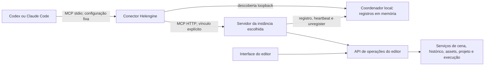

# MCP do Helengine Editor

Data: 2026-10-15.

Status: especificação aprovada em 2026-10-15, revisada por orientação de Helena para substituir a descoberta em arquivos por um coordenador local independente e considerar Windows, Linux e macOS. O mecanismo de autenticação/bootstrap dessa revisão permanece pendente. Não representa funcionalidade já implementada.

## 1. Objetivo e decisões aprovadas

Permitir que Codex e Claude Code operem o editor inteiro por MCP, incluindo o estado vivo e as alterações ainda não salvas. O resultado deve permitir trabalhar com vários editores e várias conversas sem reconfigurar portas nem misturar destinos.

Decisões aprovadas:

- Cada instância do editor hospeda seu próprio servidor MCP HTTP.
- O acesso é local, em `127.0.0.1`.
- A porta é escolhida automaticamente ao abrir o servidor.
- Um processo coordenador local independente mantém em memória o registro vivo das instâncias. O primeiro editor o inicia sob demanda; ele permanece entre fechamentos enquanto houver outros editores registrados e encerra após o último unregister ou expiração da lease.
- Um conector local, configurado uma única vez em cada cliente, recebe MCP por stdio, consulta o coordenador e encaminha as chamadas diretamente ao servidor HTTP do editor escolhido.
- O endereço loopback de descoberta do coordenador é estável e configurável uma única vez; não há valor numérico de porta fixado nesta especificação.
- A conversa escolhe explicitamente a instância por uma operação de bind. As chamadas seguintes carregam o identificador desse vínculo.
- As ferramentas usam operações do editor compartilhadas com a interface, extraindo serviços onde a lógica ainda estiver em painéis.
- A API trabalha com estado vivo, salvamento explícito, histórico compartilhado, alvos e escopos explícitos, detecção de conflito e acompanhamento de operações demoradas.
- A entrega cobre o editor inteiro. As etapas de implementação não reduzem o escopo final a um MVP de inspeção ou a algumas ferramentas.

O sucesso é verificável: depois da instalação inicial do conector, abrir ou reabrir um editor em outra porta exige apenas descobrir e vincular a instância na conversa. Duas conversas podem operar editores diferentes simultaneamente. Uma chamada nunca muda de editor por causa de foco da janela, reinício, porta reutilizada ou mudança de seleção global.

## 2. Arquitetura e responsabilidades



O conector é iniciado pelo cliente MCP. Sua duração acompanha a conexão que o cliente mantém; não se presume um processo exclusivo por conversa. O coordenador é um processo local independente, iniciado sob demanda pelo primeiro editor e encerrado quando não há mais instâncias vivas. Ele atende somente descoberta e registro; não é proxy MCP nem gateway para chamadas de ferramenta.

Responsabilidades lógicas:

| Componente | Responsabilidade |
| --- | --- |
| Host MCP do editor | Listener HTTP, autenticação local, identidade da instância, protocolo MCP e encerramento ordenado |
| Coordenador local | Manter registros vivos em memória, leases, health/protocol check e lifecycle concorrente do processo |
| Conector | Consultar descoberta, conectar diretamente ao editor, preservar vínculos explícitos e adaptar stdio/HTTP |
| Catálogo de ferramentas | Esquemas e descrições das operações, metadados de capacidade e compatibilidade |
| API de operações | Validar alvos, revisões e escopos; executar pelos serviços compartilhados; produzir resultados estruturados |
| Coordenação de execução | Encaminhar acesso ao estado vivo para a thread do editor e acompanhar trabalhos demorados |

Essa separação define responsabilidades. A divisão física em projetos e arquivos deverá ser explicitada no plano de implementação, seguindo os padrões existentes e sem introduzir um framework geral de injeção de dependências.

O MCP embutido também permanece utilizável diretamente por um cliente HTTP que conheça seu endereço. A ausência do conector não altera as regras de identidade, alvos, revisões ou histórico.

## 3. Descoberta e identidade

Cada editor solicita ao sistema operacional uma porta livre por bind com porta zero para seu próprio endpoint MCP. O registro só é enviado depois de o endpoint estar pronto. O coordenador tem um endereço loopback estável, configurável uma única vez, e mantém os registros apenas em memória.

Cada registro contém:

- `instance_id`: identidade aleatória desta execução do editor, independente do PID e da porta;
- PID e horário de início, usados como informações auxiliares;
- versão do editor e versão do contrato de automação;
- nome do projeto, raiz absoluta canônica e geração do projeto aberto;
- endpoint HTTP efetivo e estado de disponibilidade;
- informação de lease/heartbeat para detectar uma instância que caiu sem unregister.

O coordenador é iniciado sob demanda pelo primeiro editor. Somente o processo coordenador faz bind e mantém o listener; os editores não abrem nem transferem esse socket. Em inicializações concorrentes, processos candidatos disputam o bind exclusivo: apenas o vencedor continua servindo, e os candidatos que perderam encerram. Os editores verificam saúde e versão do serviço com tentativas limitadas durante início e encerramento. Se a porta estiver ocupada por um processo que não responde ao protocolo esperado, a inicialização falha com diagnóstico; nenhum processo externo é encerrado. O valor numérico da porta não é escolhido aqui.

`list_editors` consulta o coordenador e verifica os candidatos no endpoint do editor. Um registro em memória não prova que o endpoint ainda está vivo. Antes de vincular, o conector verifica identidade e compatibilidade no endpoint. PID ou porta isoladamente não são suficientes. O coordenador nunca encaminha chamadas MCP: depois da descoberta, o conector fala diretamente com o editor selecionado.

No encerramento normal, o editor faz unregister antes de parar seu host HTTP. O coordenador continua vivo enquanto houver outras instâncias registradas; após o último unregister, inicia seu encerramento ordenado. Se o editor cair, a lease expira e o coordenador remove o registro obsoleto. Uma queda do coordenador não encerra os editores: eles detectam a indisponibilidade, ajudam a iniciar novamente o processo com posse exclusiva e registram de novo suas identidades/endpoints após o health/protocol check. Retry é limitado e nenhuma mutação é repetida automaticamente durante reconexão.

Registrar uma instância e decidir encerrar por ausência de instâncias são operações serializadas no coordenador. Se o registro novo vencer a corrida, ele impede o encerramento por lista vazia; se o encerramento vencer, o registro é recusado e o editor tenta iniciar/contatar o próximo coordenador. Não confirmar um novo registro e depois encerrar por uma decisão anterior de lista vazia. A mesma regra vale para expiração da última lease. Um coordenador recém-iniciado aguarda o registro inicial por prazo limitado, evitando tanto sair antes do primeiro registro quanto ficar órfão se o editor iniciador cair.

As credenciais de cada editor permanecem privadas e não fazem parte das respostas públicas de descoberta. A autenticação/bootstrap para iniciar o coordenador, registrar editores, consultar descoberta e obter autorização para conectar ainda é uma decisão de arquitetura pendente; esta especificação não escolhe um mecanismo nem reduz isolamento entre usuários do sistema.

Projetos com o mesmo nome, cópias em diretórios diferentes e duas instâncias do mesmo projeto aparecem como destinos distintos. O nome ajuda na escolha, mas a chamada de bind usa `instance_id`.

## 4. Vínculo entre conversa e editor

Ferramentas de conexão propostas:

| Ferramenta | Contrato |
| --- | --- |
| `list_editors` | Retorna instâncias verificadas e informações para escolher o destino |
| `bind_editor(instance_id)` | Valida identidade e compatibilidade e cria um vínculo novo |
| `get_binding(binding_id)` | Consulta destino, projeto, geração e disponibilidade do vínculo |
| `unbind_editor(binding_id)` | Libera apenas aquele vínculo, sem fechar o editor |

O servidor da instância valida e emite o vínculo; o conector mantém o roteamento correspondente. Um `binding_id` identifica exatamente uma execução e uma geração de projeto. Toda ferramenta que acessa um editor exige esse identificador. Operações de descoberta não exigem vínculo prévio.

Não existe variável global de “editor atual”, e fazer um segundo bind não redireciona o primeiro. Duas conversas que compartilhem uma conexão continuam podendo usar vínculos diferentes. O vínculo é um identificador de roteamento, não uma credencial nem uma prova de isolamento de segurança entre conversas do mesmo usuário.

O cliente recebe a identidade e o projeto no resultado do bind. Pode guardar o `binding_id` no contexto da conversa e usá-lo nas chamadas seguintes. Não se depende de obter um ID interno de conversa do Codex ou do Claude.

Exemplo conceitual de uma edição:

```json
{
  "binding_id": "binding-A",
  "scene_handle": "scene-generation-A",
  "entity_id": "42",
  "component_id": "component-A",
  "property_path": "Transform.Position",
  "scope": { "kind": "common" },
  "expected_revision": "revision-17",
  "operation_id": "operation-A",
  "value": [1, 2, 3]
}
```

Nomes e valores do exemplo ilustram o contrato; os esquemas concretos e os identificadores de propriedades vêm do catálogo do editor.

Regras de invalidação:

- Fechar ou reiniciar o editor invalida os vínculos daquela execução.
- Trocar o projeto invalida os vínculos da geração anterior, mesmo que o processo continue aberto.
- Trocar ou recarregar a cena invalida seus handles antigos; o vínculo com o projeto pode continuar válido.
- Reiniciar o conector pode exigir novo bind. Não se promete persistência transparente dos vínculos.
- Perder temporariamente a conexão permite verificar novamente o mesmo destino. Não autoriza selecionar outra instância nem repetir uma mutação incerta.
- Reabrir o editor em outra porta exige novo bind na conversa, sem editar a configuração do cliente.

O editor apresenta seu projeto, endereço MCP, disponibilidade e vínculos ativos. Desvincular um cliente não fecha a aplicação nem desfaz alterações já realizadas.

## 5. Contrato das ferramentas

O catálogo contém ferramentas por operação e domínio, com entradas e saídas estruturadas. Não utiliza uma ferramenta universal de execução de código como substituto para a cobertura funcional.

Esquemas do contrato podem estar disponíveis no conector antes de existir um editor aberto. A disponibilidade efetiva de cada operação vem do endpoint vinculado. O bind verifica compatibilidade entre o contrato do conector e o do editor; diferenças incompatíveis retornam erro identificável.

Tipos de componentes, propriedades editáveis, tipos de assets, plataformas e comandos de extensões são consultados por ferramentas de catálogo. Não se cria uma ferramenta diferente para cada propriedade ou componente de projeto. Essa abordagem mantém o catálogo utilizável com componentes personalizados e com hot reload.

Regras comuns:

- Cada alvo pertence ao projeto e à geração indicados pelo vínculo.
- IDs retornados pelas consultas são usados nas escritas; nomes e posições em listas não são identidades.
- Consultas extensas têm paginação, filtros e indicação explícita de truncamento.
- Consultas de estado vivo retornam a revisão necessária para uma escrita posterior.
- Escritas validam tipo, referências, capacidade, editabilidade e escopo antes de alterar o alvo.
- Escopos comum, plataforma e plataforma/ambiente são explícitos. Não se inferem da aba aberta.
- Resultados identificam destino, alterações, revisão resultante, estado de salvamento e suporte a undo.
- Erros preservam causa e contexto útil. Não retornam sucesso após fallback silencioso.

O contrato distingue erros como `editor_unavailable`, `binding_invalid`, `project_changed`, `stale_target`, `revision_conflict`, `unsupported_operation`, `validation_failed`, `unsaved_changes` e `operation_state_unknown`. Os nomes finais fazem parte do catálogo versionado.

## 6. API compartilhada, thread e concorrência

A interface e o MCP chamam as mesmas operações de domínio. O transporte não modifica diretamente objetos por reflexão irrestrita, não grava cenas por fora da sessão aberta e não usa controles visuais como API.

Quando uma regra estiver dentro de um painel, a implementação extrai apenas a operação necessária para um serviço compartilhado, mantendo apresentação e eventos de UI no painel. A extração preserva validação, overrides, histórico, estado sujo e atualização visual.

Leituras e mutações do estado vivo passam pela thread do editor. Respostas são snapshots serializáveis; o servidor HTTP não retém referências mutáveis para ler em outra thread. A fila existente é um ponto de integração, mas precisa receber adaptação para resultados, erros, cancelamento antes do início e encerramento.

Cada chamada tem seu erro isolado e entregue ao cliente. Uma falha não pode escapar do adaptador MCP e interromper silenciosamente o processamento das chamadas seguintes.

Revisões usadas para concorrência incluem mudanças pela interface, pelo MCP, por undo/redo e pelas atualizações relevantes de serviços. Conferir a revisão e aplicar a escrita ocorre no mesmo trecho serializado na thread do editor. Somente serializar chamadas não é suficiente para detectar que a leitura da IA ficou obsoleta.

Em caso de conflito, o cliente recebe a revisão atual e precisa reler o alvo antes de decidir sobre uma nova escrita. Alterar a seleção visual não muda o alvo de uma operação já enfileirada.

Uma cena nova ou recarregada recebe uma geração própria; isso evita que um ID numérico reutilizado passe a identificar outro objeto para uma chamada antiga.

## 7. Histórico, salvamento e transições

Operações reversíveis usam o histórico existente. O histórico é compartilhado com a interface e com outros clientes; não há uma pilha privada de undo por conversa.

As consultas de histórico informam o cursor e a descrição da operação disponível. Undo/redo exigem o cursor esperado para evitar desfazer uma alteração mais recente de Helena ou de outra conversa sem perceber. Não se promete desfazer seletivamente uma operação antiga pulando alterações posteriores.

Criar, remover, reorganizar e editar elementos reversíveis preserva as regras de captura e restauração do editor. Assets e configurações usam suas regras reais de persistência; não se promete que todo efeito em disco possa ser desfeito pela pilha de cena.

Editar uma cena não a salva automaticamente. Operações de salvar e salvar como são explícitas e observam as revisões correspondentes. Edições que já persistem imediatamente no editor, como determinadas configurações de projeto, mantêm essa semântica e a declaram no catálogo.

Abrir outra cena, trocar projeto, fechar ou recarregar não descarta alterações implicitamente. A chamada informa uma política explícita: falhar se houver alterações, salvar antes ou descartar explicitamente. O padrão é retornar `unsaved_changes`, com informações suficientes para resolver a situação. A chamada não fica esperando indefinidamente por um diálogo modal invisível ao cliente.

Trabalhos que usam arquivos salvos, como determinados builds, informam sua fonte de dados. Estado vivo não deve ser apresentado como incluído num build se o executor consumiu apenas arquivos em disco. Qualquer salvamento necessário respeita a política explícita da chamada.

## 8. Operações demoradas e resultados incertos

Builds, imports e outros trabalhos demorados retornam `job_id`, estado e formas de consultar progresso, logs e resultado. O editor continua respondendo a consultas durante a execução.

Estados distinguem espera, execução, sucesso, falha, solicitação de cancelamento e cancelamento efetivamente concluído. Pedir cancelamento não equivale a ter cancelado. Quando o executor não suporta interrupção numa etapa, isso é informado e o cancelamento ocorre no próximo limite suportado.

Processamento fora da thread principal usa entradas capturadas e dependências apropriadas; acesso posterior ao estado vivo retorna à thread do editor. Não se move um serviço inteiro para uma thread de trabalho sem verificar suas dependências de renderização e de sessão.

Fechar a conexão do cliente não significa cancelar um trabalho do editor. O trabalho pode continuar e ser consultado por um vínculo válido com a mesma instância. A política de fechamento da aplicação integra o shutdown existente e informa trabalhos pendentes.

Toda mutação recebe `operation_id`. Na mesma instância e vínculo, repetir o mesmo ID com o mesmo payload consulta ou retorna a execução já conhecida; reutilizá-lo com payload diferente é erro. O registro de operações permanece durante a vida do vínculo. Ao atingir seu limite, novas mutações são recusadas explicitamente até haver liberação, sem evicção silenciosa que permita duplicações.

Timeout ou perda da resposta não provam que uma edição falhou. O cliente consulta o estado da operação antes de tentar novamente. Se o processo do editor morreu e o resultado não pode ser reconstruído, retorna estado desconhecido e exige inspeção do projeto; não há garantia de execução exatamente uma vez entre crashes.

## 9. Matriz de cobertura funcional

Esta é a matriz de requisitos por domínio, não uma afirmação de que todos os serviços abaixo já estejam prontos. O plano de implementação deve expandi-la em operações concretas, com serviço proprietário, ferramenta, esquema, persistência, histórico, restrições e teste correspondente.

| Domínio | Cobertura exigida | Contratos importantes |
| --- | --- | --- |
| Instância e vínculo | Descobrir, vincular, consultar estado, desvincular e identificar projeto/cena | Sem seleção global; invalidação por geração |
| Cenas | Criar, abrir, salvar, salvar como, recarregar, fechar e editar configurações | Handles de cena; alterações não salvas |
| Hierarquia | Consultar, buscar, criar, duplicar, remover, renomear, ativar, reorganizar e reparentar | IDs estáveis e regras de hierarquia; undo quando suportado |
| Componentes | Descobrir tipos, consultar, adicionar, remover e editar propriedades simples, compostas e referências | Catálogo tipado, validação e histórico |
| Componentes do projeto | Inspecionar e editar componentes personalizados e reagir a mudanças de esquema | Refresh após hot reload; invalidar metadados obsoletos |
| Overrides | Consultar valores efetivos e próprios; criar, alterar e remover overrides | Escopo comum/plataforma/ambiente explícito |
| Assets e biblioteca | Buscar, consultar metadados, criar, importar, reimportar, mover, renomear e excluir | Identidade e referências preservadas; sem contornar autoria |
| Editores de assets | Cobrir as operações existentes de materiais, animações e demais tipos editáveis | Mesmas validações e regras de persistência da interface |
| Referências e geração | Resolver referências, consultar dependências e acionar autoria/provedores existentes | Usar a sessão de autoria e as transações existentes |
| Seleção e viewport | Consultar/alterar seleção, enquadrar, navegar, controlar projeção e modos disponíveis | Alvo explícito; sem depender do foco da janela |
| Projeto | Consultar e editar configurações, catálogo/roteamento de cenas e opções existentes | Raiz e geração do projeto; persistência declarada |
| Plataformas e ambientes | Gerenciar opções habilitadas, grupos, ambientes, perfis e configurações associadas | Respeitar capacidades reais das plataformas |
| Workspace | Consultar e operar painéis, layouts e preferências disponíveis | Estado do editor separado do conteúdo de cena |
| Play | Consultar capacidades/estado, configurar, iniciar e parar; demais controles existentes | Respeitar o player e suas capacidades; acompanhar processo |
| Builds | Configurar destinos, perfis e fila; iniciar, acompanhar e cancelar | Jobs, arquivos efetivamente usados, logs e artefatos |
| Diagnóstico | Ler logs paginados, erros de import/build/scripts e estado das operações | Cursores e retenção explícita; falhas preservadas |
| Histórico | Consultar histórico disponível, undo e redo | Cursor esperado; histórico compartilhado |
| Extensões | Descobrir e executar comandos de projeto e operações registradas | Metadados de efeitos, validação e capacidades |

Para cada operação existente exposta por menu, inspector, painel, atalho ou comando de projeto, a matriz detalhada precisa indicar a ferramenta correspondente ou justificar por que se trata apenas de apresentação sem operação de domínio. Uma operação funcional sem equivalente fica registrada como lacuna de entrega. Não pode ser omitida silenciosamente sob o rótulo “full editor”.

Novas funcionalidades do produto, como executar código arbitrário enviado pelo cliente ou oferecer controles que o player ainda não possui, não são presumidas a partir de “full editor”. Se necessárias para algum caso de uso, exigem decisão explícita de escopo. Captura de tela/janelas durante desenvolvimento ou validação depende da autorização específica já exigida pelas regras do repositório.

## 10. Pontos de integração verificados no código

O índice estrutural consultado estava datado de 2026-09-23 e sinalizava alterações posteriores. A investigação usou leitura direta de fontes atuais para as conclusões abaixo. Documentos anteriores de design servem como contexto, não como prova de implementação concluída.

| Fonte atual | Evidência e implicação |
| --- | --- |
| `C:\dev\helworks\helengine\engine\helengine.editor\EditorSession.cs` | Compõe serviços, processa ações na thread do editor e possui ciclo de encerramento; integração não deve concentrar novas regras de domínio nessa classe |
| `C:\dev\helworks\helengine\engine\helengine.editor\managers\play\EditorMainThreadActionQueue.cs` | Fila thread-safe drenada por frame; atualmente uma ação que lança exceção interrompe aquela drenagem, exigindo isolamento no adaptador de requisições |
| `C:\dev\helworks\helengine\engine\helengine.editor\history\EditorMutationService.cs` | Registra alterações reversíveis e notificações de cena modificada; deve ser reutilizado |
| `C:\dev\helworks\helengine\engine\helengine.editor\history\IEditorUndoRedoService.cs` | Contrato de undo/redo e estado salvo; revisões externas e cursor esperado exigem integração adicional |
| `C:\dev\helworks\helengine\engine\helengine.editor\managers\inspection\ComponentPropertyEditController.cs` | Centraliza validação, persistência de overrides e histórico de edições de propriedades |
| `C:\dev\helworks\helengine\engine\helengine.editor\managers\inspection\ComponentPropertyEditRequest.cs` | Já representa alvo e escopo de uma edição; deve ser adaptado a identificadores serializáveis, sem expor objetos de runtime no protocolo |
| `C:\dev\helworks\helengine\engine\helengine.editor\managers\scene\EditorSceneLifecycleService.cs` | Mantém cena atual, estado sujo e transições pendentes; as políticas MCP precisam integrar essas regras |
| `C:\dev\helworks\helengine\engine\helengine.editor\managers\asset\IEditorProjectAuthoringSession.cs` | Fronteira de autoria por projeto para identidade, referências e gravação de assets |
| `C:\dev\helworks\helengine\engine\helengine.editor\managers\project\IEditorCommandContext.cs` | Fornece capacidades da sessão a comandos de projeto; não equivale por si só a uma API MCP completa |
| `C:\dev\helworks\helengine\engine\helengine.editor\managers\project\EditorCommandExecutionService.cs` | Resolve e executa comandos de projeto por identificador |
| `C:\dev\helworks\helengine\engine\helengine.editor\managers\play\EditorPlaySessionService.cs` | Possui estado e operações de Play, Stop e shutdown; não se presume cancelamento universal de todas as suas etapas |
| `C:\dev\helworks\helengine\engine\helengine.editor\managers\project\EditorBuildQueueService.cs` | O fluxo inspecionado executa itens sincronamente; jobs MCP responsivos exigem adaptação real do fluxo, não apenas embrulhar a chamada HTTP |

O projeto de editor inspecionado tem alvo `net9.0`; o host Windows usa `net9.0-windows`. A escolha de biblioteca MCP e hospedagem HTTP deve comprovar compatibilidade com esses projetos e com sua distribuição antes de ser fixada no plano. Não se assume que uma atualização do runtime faz parte deste trabalho.

O MCP deve acompanhar o editor no Windows, Linux e macOS. HTTP local, coordenador de descoberta, credenciais e vínculo por conversa são requisitos nas três plataformas. A plataforma da máquina de desenvolvimento não determina a arquitetura do produto nem autoriza introduzir uma versão mínima de Windows por conveniência de implementação. A autenticação/bootstrap e a privacidade entre usuários precisam permanecer corretas nas três plataformas; seu mecanismo ainda está pendente.

## 11. Transporte, acesso local e integração com clientes

O endpoint usa MCP Streamable HTTP. A implementação fixa uma combinação de versão de protocolo e SDK suportada pelos clientes testados; não adota uma revisão draft apenas por ser mais recente. A sessão de transporte MCP, quando existir na versão escolhida, não substitui `binding_id`.

O listener MCP de cada editor aceita apenas loopback. Cada instância conserva credencial própria e privada, obtida fora do contexto da conversa; logs, ferramentas de descoberta e resultados não expõem segredos. A autenticação/bootstrap do coordenador, registro, consulta de descoberta e autorização para conectar permanece uma decisão pendente. Não se presume que a descoberta loopback entregue credenciais sem autenticação nem que o coordenador reduza o isolamento por usuário.

O host valida origem quando presente e as regras de host/endpoint. O conector verifica identidade e compatibilidade antes de encaminhar operações e só usa registros locais verificados; não aceita redirecionamento silencioso para outro host.

Configuração inicial: registrar o executável do conector como servidor stdio no Codex e no Claude Code. A configuração contém o comando estável, não a porta do editor. As instruções exatas de instalação usam caminhos absolutos na máquina de destino e devem considerar atualização do executável sem mudar o comando configurado.

O conector pode iniciar sem editores abertos; descoberta retorna lista vazia e as ferramentas de conexão continuam utilizáveis. Abrir um editor inicia o coordenador sob demanda e permite vinculá-lo sem reinstalar ou reconfigurar o conector. Fechar um editor não encerra o coordenador enquanto outro estiver registrado; ao fechar o último, ele encerra após unregister/expiração da lease. A porta do endpoint de cada editor continua efêmera e não exige mudança da configuração do cliente.

A compatibilidade inicial deve ser validada no Codex CLI e no Claude Code. Interfaces desktop/IDE precisam de validação específica, sobretudo quanto a configuração, compartilhamento de conexões, reconexão e disponibilidade de ferramentas. Suporte documentado ao transporte não prova isolamento por conversa nem comprova essas interfaces.

## 12. Validação e critérios de aceite

### Conexão e múltiplas instâncias

1. Abrir dois editores em portas MCP automáticas e trabalhar em cada um por vínculos diferentes através de um coordenador local estável.
2. Abrir duas instâncias do mesmo projeto e distinguir seus destinos sem usar nome ou porta como identidade.
3. Usar dois vínculos na mesma conexão MCP e comprovar que um bind novo não redireciona o anterior.
4. Fechar e reabrir um editor, inclusive com reutilização da porta, e rejeitar o vínculo antigo; comprovar que o primeiro fechamento não encerra o coordenador enquanto o segundo editor estiver aberto.
5. Simular lease expirada, endpoint com identidade divergente e credencial inválida.
6. Iniciar o cliente antes dos editores; abrir dois editores, fechar o primeiro e comprovar que coordenador e descoberta continuam disponíveis para o segundo; fechar o último e comprovar o encerramento ordenado do coordenador.
7. Disputar inicialização concorrente do coordenador, rejeitar um listener ocupado por processo alheio sem encerrá-lo e verificar bounded retry.
8. Encerrar abruptamente o coordenador enquanto editores permanecem abertos; comprovar recuperação, re-registro e ausência de replay de mutação.
9. Iniciar o cliente antes dos editores e conectar depois sem editar configuração; repetir nos clientes suportados e registrar versões e interfaces.

### Edição e estado

8. Criar, editar, reparentar e remover entidades pelo MCP, verificando resultado no estado vivo, histórico e persistência após salvar/reabrir.
9. Editar propriedades comuns e overrides de plataforma/ambiente sem alterar outro escopo.
10. Alterar o objeto pela interface entre leitura e escrita MCP e receber conflito.
11. Trocar/recarregar cena e rejeitar handles antigos, mesmo com IDs numéricos reutilizados.
12. Fazer alterações por duas conversas e pela interface; validar que undo exige o cursor atual e usa a mesma pilha.
13. Tentar transição com alterações não salvas e validar as políticas de erro, salvar e descarte explícito.
14. Exercitar cada domínio da matriz detalhada, incluindo componentes de projeto e editores especializados de assets.

### Execução e falhas

15. Executar trabalho demorado mantendo consultas responsivas e observando progresso, resultado e cancelamento real.
16. Perder a resposta de uma mutação e consultar/repetir o mesmo `operation_id` sem duplicar o efeito.
17. Reutilizar um `operation_id` com outro payload e receber erro; testar o limite de retenção sem reaplicar IDs antigos.
18. Provocar exceção numa operação enfileirada e verificar erro entregue, continuidade da fila e integridade do editor.
19. Encerrar o editor com chamadas pendentes sem deixar tarefas aguardando indefinidamente ou acessando recursos já liberados.
20. Verificar que builds relatam corretamente o uso de dados salvos e que mudanças não salvas não desaparecem por salvamento implícito.

### Critério de conclusão

A entrega só é completa quando a matriz detalhada não contém lacunas funcionais não aprovadas, os clientes suportados passam pelos cenários de conexão e isolamento e os domínios preservam suas regras de edição. Ferramentas listadas, mas não exercitadas contra o editor, não contam como cobertura concluída.

Validação automática deve focar contratos, serviços e integração HTTP/stdio. Testes reais de cliente e editor complementam esses testes. Executar apenas os checks pertinentes a cada etapa; não rodar builds de todas as plataformas por uma alteração de documentação ou transporte.

## 13. Sequência proposta para o plano de implementação

1. Inventariar as operações atuais e expandir a matriz de cobertura, verificando serviços e testes proprietários.
2. Validar a combinação de SDK/protocolo e a integração dos clientes; registrar as escolhas técnicas para revisão antes de qualquer mudança arquitetural adicional.
3. Implementar contrato, identidades, host HTTP por editor, coordenador local em memória, conector e vínculo explícito, com testes de lifecycle, várias instâncias e conexões compartilhadas.
4. Integrar despacho na thread do editor, revisões, histórico, política de salvamento, resultados de operações e shutdown.
5. Cobrir cenas, hierarquia, componentes e overrides; depois assets, projeto, workspace, viewport e extensões, conforme dependências identificadas.
6. Adaptar Play, builds e imports para acompanhamento de trabalhos, cancelamento suportado e diagnósticos.
7. Integrar a apresentação da conexão no editor, distribuição do conector e instruções de instalação.
8. Fechar a matriz e validar os fluxos completos com Codex e Claude Code.

Essa sequência orienta a elaboração do plano; não é autorização para iniciar a implementação. O plano posterior precisa decompor tarefas em arquivos, dependências, testes e critérios verificáveis, sem presumir concluídas as extrações de serviços ainda necessárias.

## 14. Referências

- [MCP no Codex: configuração de servidores stdio e HTTP](https://learn.chatgpt.com/docs/extend/mcp?surface=cli).
- [MCP no Claude Code: servidores locais stdio e configuração](https://code.claude.com/docs/en/mcp).
- [Especificação MCP Streamable HTTP em evolução](https://github.com/modelcontextprotocol/modelcontextprotocol/blob/main/docs/specification/draft/basic/transports/streamable-http.mdx). Referência de conceitos; a revisão draft não é uma versão escolhida para implementação.
- Contexto de autoria: `C:\dev\helworks\helengine\docs\superpowers\specs\2026-08-26-deterministic-editor-authoring-design.md`.
- Contexto de modularização: `C:\dev\helworks\helengine\docs\superpowers\specs\2026-08-26-editor-modularization-design.md`.

As documentações de cliente foram consultadas em 2026-10-15. O suporte a stdio foi documentado para ambos; o mecanismo de descoberta, bind e roteamento descrito aqui é uma proposta própria do Helengine, não uma funcionalidade nativa presumida dos clientes.
